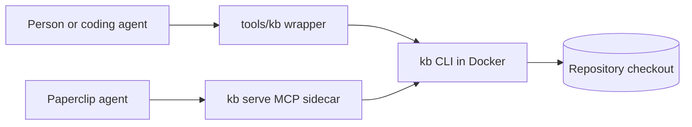

# System overview

kb-tools is a Python package (`kbtools`) packaged as a Docker image with LibreOffice and a
font set. The same image runs as a CLI against a mounted repository (`tools/kb`) or as an MCP
server (`kb serve`) next to an agent platform.

## Components

| Component | Responsibility | Module |
| --- | --- | --- |
| CLI | Parses `kb <command>` and calls the modules | `cli.py` |
| Intake | `init`, `inventory`, `log`: the git-ignored sources folder and `ingest-log.csv` | `intake.py`, `ingest_log.py` |
| Extraction | Builds `extracted/<slug>/`: MarkItDown text, LibreOffice PDF, page renders, PowerPoint structure, workbook formulas, media, manifest | `extract.py` |
| Figures | Crops and resizes renders into `docs/**/assets/`, prints Markdown | `figure.py` |
| Checks | Ingest log, OKF front matter, links, images, diagram descriptions, work tree, catalog freshness | `check.py`, `okf.py` |
| Trust report | Verification tier, recency and flags per page | `report.py` |
| Catalog | `docs/catalog.md` and filtered md/json/jsonl output | `catalog.py` |
| Work tracking | Epics, plans, items, roadmap | `work.py` |
| Scaffold | Installs the generic template from `kbtools/template/` | `scaffold.py` |
| MCP server | Exposes the commands as `kb_*` tools over streamable HTTP; restricts repositories to allowed roots | `server.py` |

## Architecture diagram

**Nodes**

| Node | What it is |
| --- | --- |
| Person or coding agent | Runs commands from a checkout |
| tools/kb wrapper | Shell script that runs the image with the repository mounted at `/work`, no network |
| kb CLI in Docker | The `kbtools` package, LibreOffice and fonts |
| Paperclip agent | An agent in the Paperclip container, which lacks the toolchain |
| kb serve MCP sidecar | The same image in server mode, sharing Paperclip's data volume |
| Repository checkout | Where pages, the ingest log and extraction packages are read and written |

**Edges**

| From | To | Relationship | Evidence |
| --- | --- | --- | --- |
| Person or coding agent | tools/kb wrapper | runs | visible: `bin/kb` |
| tools/kb wrapper | kb CLI in Docker | `docker run` | visible: `bin/kb` |
| Paperclip agent | kb serve MCP sidecar | MCP tool calls | visible: `server.py` |
| kb serve MCP sidecar | kb CLI in Docker | runs `kb` as a subprocess | visible: `server.py` `_run` |
| kb CLI in Docker | Repository checkout | reads and writes files | visible |

## Cross-cutting concerns

- **No network at run time:** extraction never calls the network, cloud OCR or a model.
- **Never overwrite people's work:** scaffold skips existing files; sources are never modified.
- **Provenance:** every extraction records hashes and tool versions.
