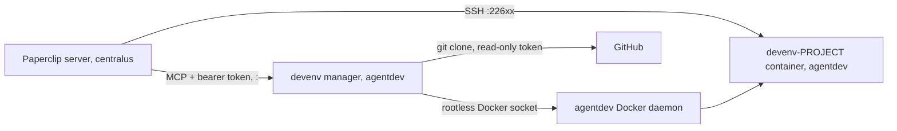

# Agent dev environments

Paperclip agents develop and test inside **per-project dev containers** on the Paperclip host, through
Paperclip's SSH execution environment. The containers are built from each repository's
`.devcontainer/` by the **devenv manager** (`devenv/` in this repository) and run under an
isolated account. Epic 0010 tracks the work ([roadmap](../work/index.md)).



**Nodes**

| Node | What it is |
| --- | --- |
| Paperclip server | Runs the agent harness locally, or remotely through an SSH environment |
| devenv-PROJECT container | Project dev image plus agent overlay: sshd (user `agent`, key-only, no sudo), node, claude CLI, git |
| devenv manager | MCP server (`kb-devenv` image) in `~agentdev/stacks/devenv` |
| agentdev Docker daemon | Rootless Docker of the `agentdev` account (its own uid) |
| GitHub | Project repositories (private: the manager needs a read-only token) |

**Edges**

| From | To | Relationship | Evidence |
| --- | --- | --- | --- |
| Paperclip server | devenv-PROJECT container | SSH execution (workspace synced per run) | visible: SSH trial 2026-11-05 |
| Paperclip server | devenv manager | MCP tool calls through a Paperclip connection | visible: client test 2026-11-05 |
| devenv manager | agentdev Docker daemon | builds and runs containers | visible: `compose.yaml` socket mount |
| devenv manager | GitHub | clones repositories to build | visible: `server.py` `_clone` |

## Isolation

- `agentdev` (its own uid): locked password, no sudo, no groups, linger, its own rootless Docker.
  Agents' builds and installs cannot reach Paperclip, its database or its secrets.
- Egress (`/etc/nftables-org-isolation.nft`): internet, DNS and the LLM gateway only; LAN,
  tailnet and other accounts' ports are rejected (verified 2026-11-05).
- Paperclip (centralus) reaches dev containers and the manager on `<host-ip>` (internal
  dummy interface, not exposed to the LAN) in its allowed range: manager `<manager-port>`, dev
  containers `<port-range>`.
- The manager requires a bearer token known only to the Paperclip connection, so agents cannot
  call it directly and bypass Paperclip's approvals.

## Registering a project's environment in Paperclip (instance admin)

Done once per project, after `devenv_create` reports `running`:

1. **Settings → Secrets:** company secret `DEVENV_SSH_KEY` holds the manager's private key
   (`~agentdev/stacks/devenv/data/keys/paperclip`), created once for all projects.
2. **Environments → new SSH environment** with the values `devenv_status` returns:
   - host `<host-ip>`, the project's port, user `agent`;
   - remote workspace `/home/agent/workspace`;
   - private key from `DEVENV_SSH_KEY`;
   - the `knownHosts` line, with strict host-key checking on.
3. **Project settings → environment:** select it, then run a probe.

## Operations

```sh
# as reviewer on the Paperclip host
A="sudo -u agentdev env XDG_RUNTIME_DIR=/run/user/1006 DOCKER_HOST=unix:///run/user/1006/docker.sock"
$A docker compose --project-directory /home/agentdev/stacks/devenv ps        # manager
$A docker ps --filter label=devenv.project                                   # dev containers
sudo cat /home/agentdev/stacks/devenv/data/logs/<project>.log                # build log
sudo cat /home/agentdev/stacks/devenv/data/state.json                        # ports, status, installs
```

Update the manager: copy `devenv/` to `~agentdev/stacks/devenv` (keeping `data/` and `.env`),
then `docker compose up -d --build`.

> TODO: Add the read-only GitHub token (`GITHUB_TOKEN` in `~agentdev/stacks/devenv/.env`) so the
> manager can clone the private repositories, then rebuild kb-tools' environment from GitHub.
