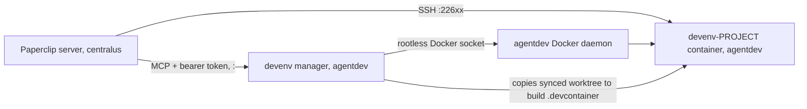

# Agent dev environments

Paperclip agents develop and test inside **per-project dev containers** on the Paperclip host, through
Paperclip's SSH execution environment. The containers are built from each repository's
`.devcontainer/` by the **devenv manager** (`devenv/` in this repository) and run under an
isolated account. The manager holds no GitHub credential: Paperclip syncs the worktree into
the container on every run and writes new commits back, and pushes go through Paperclip's
managed GitHub launchers. Epic 0010 tracks the work ([roadmap](../work/index.md)).



**Nodes**

| Node | What it is |
| --- | --- |
| Paperclip server | Runs the agent harness locally, or remotely through an SSH environment |
| devenv-PROJECT container | Project dev image plus agent overlay: sshd (user `agent`, key-only, no sudo), node, claude CLI, git |
| devenv manager | MCP server (`kb-devenv` image) in `~agentdev/stacks/devenv` |
| agentdev Docker daemon | Rootless Docker of the `agentdev` account (its own uid) |

**Edges**

| From | To | Relationship | Evidence |
| --- | --- | --- | --- |
| Paperclip server | devenv-PROJECT container | SSH execution (workspace synced per run) | visible: SSH trial 2026-11-05 |
| Paperclip server | devenv manager | MCP tool calls through a Paperclip connection | visible: client test 2026-11-05 |
| devenv manager | agentdev Docker daemon | builds and runs containers | visible: `compose.yaml` socket mount |
| devenv manager | devenv-PROJECT container | copies the synced worktree out as the build context | visible: `server.py` `_export_workspace` |

## Isolation

- `agentdev` (its own uid): locked password, no sudo, no groups, linger, its own rootless Docker.
  Agents' builds and installs cannot reach Paperclip, its database or its secrets.
- Egress (`/etc/nftables-org-isolation.nft`): internet, DNS and the LLM gateway only; LAN,
  tailnet and other accounts' ports are rejected (verified 2026-11-05).
- Paperclip (centralus) reaches dev containers and the manager on `<host-ip>` (internal
  dummy interface, not exposed to the LAN) in its allowed range: manager `<manager-port>`, dev
  containers `<port-range>`.
- The manager requires a bearer token known only to the Paperclip connection, so agents cannot
  call it directly and bypass Paperclip's approvals.

## Setting up a project (agent, with approvals)

Once per company, the owner adds the manager as an MCP connection (`http://<host-ip>:<manager-port>/mcp`,
header `Authorization: Bearer <DEVENV_TOKEN>`) and sets **ask first** on `devenv_create`,
`devenv_rebuild` and `devenv_install`. Then, per project:

1. The agent generates an ed25519 key pair and submits the private key as a **secret proposal**
   (for example `DEVENV_SSH_KEY_<PROJECT>`); the owner approves the card. The key is never printed.
2. The agent calls `devenv_create(project, public_key, private_key_secret)` (approval card), then
   polls `devenv_status` until `running`. The container starts from the default image.
3. **Environments → new SSH environment** with the settings `devenv_status` returns (host
   `<host-ip>`, the project's port, user `agent`, workspace `/home/agent/workspace`, the
   private-key secret, the `knownHosts` line with strict checking), selected on the project, then
   probed. Instance admins do this, or an agent granted `environments:manage`.
4. After the first run has synced the repository, the agent calls `devenv_rebuild` (approval
   card). The manager builds `.devcontainer/` from the synced worktree and swaps the container
   once no agent session is running in it. Rebuild again whenever `.devcontainer/` changes.

System packages: preferably a pull request to `.devcontainer/` followed by `devenv_rebuild`, so
the review is the approval; `devenv_install` (approval card) for urgent needs, persisted for
rebuilds.

## Operations

```sh
# as reviewer on the Paperclip host
A="sudo -u agentdev env XDG_RUNTIME_DIR=/run/user/1006 DOCKER_HOST=unix:///run/user/1006/docker.sock"
$A docker compose --project-directory /home/agentdev/stacks/devenv ps        # manager
$A docker ps --filter label=devenv.project                                   # dev containers
sudo cat /home/agentdev/stacks/devenv/data/logs/<project>.log                # build log
sudo cat /home/agentdev/stacks/devenv/data/state.json                        # ports, status, installs
```

Update the manager: copy `devenv/` to `~agentdev/stacks/devenv` (keeping `data/` and `.env`),
then `docker compose up -d --build`.

kb-tools' environment predates per-project keys and uses the shared fallback key
(`data/keys/paperclip`, `DEVENV_PUBKEY`). Remove the fallback once it has its own key.
