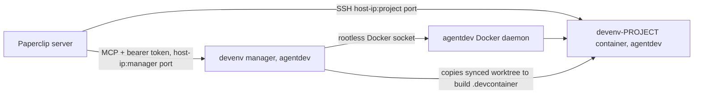

# Agent dev environments

Paperclip agents develop and test inside **per-project dev containers** on the Paperclip host, through
Paperclip's SSH execution environment. The containers are built from each repository's
`.devcontainer/` by the **devenv manager** (`devenv/` in this repository) and run under an
isolated account (called `agentdev` here). The manager holds no GitHub credential: Paperclip syncs the worktree into
the container on every run and writes new commits back, and pushes go through Paperclip's
managed GitHub launchers. Epic 0010 tracks the work ([roadmap](../work/index.md)). Every
host, address and port is a setting ([Configuration](configuration.md#devenv-manager-devenv));
the values below are placeholders.



**Nodes**

| Node | What it is |
| --- | --- |
| Paperclip server | Runs the agent harness locally, or remotely through an SSH environment |
| devenv-PROJECT container | Project dev image plus agent overlay: sshd (user `agent`, key-only, no sudo), node, claude CLI, git |
| devenv manager | MCP server (`kb-devenv` image), a compose stack in the `agentdev` account |
| agentdev Docker daemon | Rootless Docker of the `agentdev` account |

**Edges**

| From | To | Relationship | Evidence |
| --- | --- | --- | --- |
| Paperclip server | devenv-PROJECT container | SSH execution (workspace synced per run) | visible: SSH trial 2026-11-05 |
| Paperclip server | devenv manager | MCP tool calls through a Paperclip connection | visible: client test 2026-11-05 |
| devenv manager | agentdev Docker daemon | builds and runs containers | visible: `compose.yaml` socket mount |
| devenv manager | devenv-PROJECT container | copies the synced worktree out as the build context | visible: `server.py` `_export_workspace` |

## Isolation

- `agentdev`: a dedicated account with a locked password, no sudo, no groups, lingering, and its
  own rootless Docker. Agents' builds and installs cannot reach Paperclip, its database or its
  secrets.
- Egress: restrict the account's traffic (for example with nftables) to the internet, DNS, the
  model gateway and Paperclip's public HTTPS URL; reject the LAN, other accounts' ports and
  internal services.
- Why Paperclip's URL is open: `claude_local` remote runs reach the Paperclip API through the
  SSH callback bridge, but its managed `git`/`gh` launchers fetch GitHub credentials from the
  instance's public URL (`heartbeat.ts`), so SSH runs need that one path to fetch and push.
- Paperclip reaches dev containers and the manager on `DEVENV_HOST_IP` (`<host-ip>`), which
  should be a private address not exposed to the LAN: the manager on `DEVENV_MANAGER_PORT`
  (`<manager-port>`), dev containers in `DEVENV_PORTS` (`<ssh-port-range>`).
- The manager requires a bearer token known only to the Paperclip connection, so agents cannot
  call it directly and bypass Paperclip's approvals.

## Setting up a project (agent, with approvals)

Once per company, the owner adds the manager as an MCP connection (`http://<host-ip>:<manager-port>/mcp`,
header `Authorization: Bearer <DEVENV_TOKEN>`) and sets **ask first** on `devenv_create`,
`devenv_rebuild` and `devenv_install`. Then, per project:

1. The agent generates an ed25519 key pair and submits the private key as a **secret proposal**
   (for example `DEVENV_SSH_KEY_<PROJECT>`); the owner approves the card. The key is never printed.
2. The agent calls `devenv_create(project, public_key, private_key_secret)` (approval card), then
   polls `devenv_status` until `running`. The container starts from the default image.
3. **Environments → new SSH environment** with the settings `devenv_status` returns (host
   `<host-ip>`, the project's port, user `agent`, workspace `/home/agent/workspace`, the
   private-key secret, the `knownHosts` line with strict checking), selected on the project, then
   probed. Instance admins do this, or an agent granted `environments:manage`.
4. After the first run has synced the repository, the agent calls `devenv_rebuild` (approval
   card). The manager builds `.devcontainer/` from the synced worktree and swaps the container
   once no agent session is running in it. Rebuild again whenever `.devcontainer/` changes.

System packages: preferably a pull request to `.devcontainer/` followed by `devenv_rebuild`, so
the review is the approval; `devenv_install` (approval card) for urgent needs, persisted for
rebuilds.

## Deploying the manager

1. Create the `agentdev` account with rootless Docker, and copy `devenv/` to a stack folder in
   it (for example `~agentdev/stacks/devenv`).
2. Copy `devenv/.env.example` to `.env` there and fill in `DEVENV_TOKEN`, `DEVENV_HOST_IP`,
   `DEVENV_MANAGER_PORT` and `DEVENV_PORTS` ([Configuration](configuration.md#devenv-manager-devenv)).
   `.env` is git-ignored; keep the token in Paperclip secrets too.
3. `docker compose up -d --build` as `agentdev`.

## Operations

```sh
# as an admin on the Paperclip host
A="sudo -u agentdev env XDG_RUNTIME_DIR=/run/user/<agentdev-uid> DOCKER_HOST=unix:///run/user/<agentdev-uid>/docker.sock"
$A docker compose --project-directory <stack-folder> ps                      # manager
$A docker ps --filter label=devenv.project                                   # dev containers
sudo cat <stack-folder>/data/logs/<project>.log                              # build log
sudo cat <stack-folder>/data/state.json                                      # ports, status, installs
```

Update the manager: copy `devenv/` to the stack folder (keeping `data/` and `.env`), then
`docker compose up -d --build`. After changing the published address or ports, check both
the manager connection and each project's SSH environment in Paperclip.

A project created without its own key uses the shared fallback key (`DEVENV_PUBKEY`). Give it
its own key and remove the fallback when nothing needs it.
