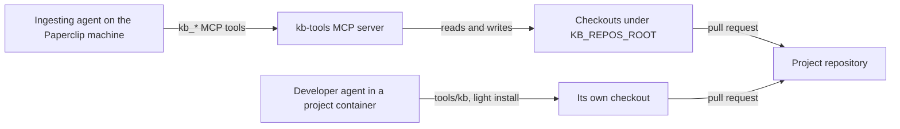

# Install kb-tools as an add-on in a Paperclip environment

kb-tools gives a Paperclip company a document-driven knowledge base and development process
for each project repository: a `docs/` knowledge base, document ingestion, repository-native
work tracking, checks and trust reports. Nothing in it is specific to one company; every
deployment value is a setting ([Configuration](configuration.md)).

## Who uses what

kb-tools runs in two places, with different commands. They are **not interchangeable**.

| Where | Who | How | Commands |
| --- | --- | --- | --- |
| **Paperclip machine**: the kb-tools MCP server, next to Paperclip | Agents that work on the Paperclip machine: the agent that ingests documents (for example a Librarian agent) and coordinators such as Chief | `kb_*` MCP tools, on checkouts under the server's repos root | everything, including the heavy `kb_extract` and `kb_figure` (LibreOffice, fonts, MarkItDown) |
| **Project containers**: each project's dev container | Developers and agents working on the project | `tools/kb` in the repository, with a light local install | `check`, `work`, `catalog`, `report`, `log`, `inventory`, `scaffold` |

The MCP server can only see the checkouts under its own repos root, not the files inside
a project's dev container. So agents in project containers use `tools/kb`, and documents
are ingested on the Paperclip machine, where the originals and the extraction libraries are.



| Element | Meaning |
| --- | --- |
| Ingesting agent | A Paperclip agent (for example a Librarian) that ingests documents with the MCP tools. |
| kb-tools MCP server | `kb serve` in the kb-tools image, a service next to Paperclip. |
| Checkouts under `KB_REPOS_ROOT` | The ingesting agent's checkouts of project repositories, which the server can see. |
| Developer agent | An agent working inside a project's dev container. |
| Its own checkout | The project checkout inside the dev container, where `tools/kb` runs. |
| Project repository | Where both sides' pull requests land. |
| Edges | MCP calls, file access, and pull requests. |

## 1. Run the MCP server on the Paperclip machine

Build the image from a kb-tools checkout (`docker build -t kb-tools:latest .`) and run it as
a service in the same Docker network as Paperclip. Mount the directory that holds the
ingesting agent's checkouts at `/repos`, the image's default `KB_REPOS_ROOT`:

```yaml
  kb-tools:
    image: kb-tools:latest
    command: ["serve"]
    restart: unless-stopped
    environment:
      KB_REPOS_ROOT: /repos            # default in the image; where checkouts are looked up
      # KB_ALLOWED_ROOTS: /paperclip   # optional: more directories absolute paths may use
    volumes:
      - <checkouts-on-the-host>:/repos
```

- The image listens on `0.0.0.0:8765` inside the container (`KB_MCP_HOST`, `KB_MCP_PORT`).
  Don't publish the port on the host unless something outside the Docker network needs it;
  if you do, bind it to a private address.
- **Repos root.** A call with `repo=gameworld` or `repo=<owner>/gameworld` uses the checkout
  at `$KB_REPOS_ROOT/gameworld` or `$KB_REPOS_ROOT/<owner>/gameworld`. Absolute paths work
  too, but only under `KB_REPOS_ROOT` or `KB_ALLOWED_ROOTS`. When the ingesting agent's
  workspace is on a volume Paperclip shares with the server, set `KB_REPOS_ROOT` to the
  folder on that volume where the agent keeps its checkouts, so both see the same files at
  the same path.
- Failed calls (unknown repo, a command that exits non-zero) come back as MCP tool errors
  (`isError: true`) whose text names the repos root and the repositories it holds.

Then add an MCP connection in Paperclip with the URL `http://<kb-mcp-host>:8765/mcp` (for a
service in Paperclip's Docker network, `<kb-mcp-host>` is its service name, such as
`kb-tools`), and bind it only to the agents on the Paperclip machine that need it. The
server's instructions repeat these rules for agents.

## 2. Set up the ingesting agent

Give the agent (for example a Librarian) a workspace on the Paperclip machine and have it
check out each project repository under the server's repos root, for example
`$KB_REPOS_ROOT/gameworld`. It ingests documents attached to Paperclip issues with
`kb_inventory`, `kb_extract`, `kb_figure`, `kb_log` and `kb_check`, following the project's
`docs/process/ingestion.md`, and opens pull requests like any other contributor. Originals
stay out of git (`docs/sources/` is git-ignored), so only the ingesting agent's checkout
holds them.

For **every** kb-tools project, the ingesting agent also takes the other two kinds of
request that need the originals or long reading: **source requests** (a developer asks for
the page, slide or sheet behind a knowledge base reference, and gets it back as attachments
on the task) and **research** (long-running web and document research, recorded in the
knowledge base with sources). The scaffold template describes all three in each project's
`docs/process/sources-and-research.md` and in a section of its `AGENTS.md`, so developers in
project containers know to route this work to the ingesting agent. Tell the agent the same
in its own instructions, and keep the source tasks' attachments: until there is a host backup
of its `docs/sources/` folders, they are the backup.

## 3. Start using kb-tools in a project

Once per project, from a kb-tools install (the MCP server's `kb_scaffold`, or `tools/kb` /
`kb` anywhere):

```sh
kb scaffold --project <name>     # never overwrites existing files
```

This adds the knowledge base (`docs/`), the agent instructions (`AGENTS.md`, `CLAUDE.md`),
`tools/kb` and `tools/kb.conf`, which records where kb-tools is installed from: `source=`,
and `ref=`, the branch or tag the scaffolding kb-tools was installed from (`main` if
unknown). Commit them in a pull request.

Then give the ingesting agent ([section 2](#2-set-up-the-ingesting-agent)) a checkout of the
new project under `KB_REPOS_ROOT`, for example `$KB_REPOS_ROOT/<name>`, and confirm that its
`kb_work_list` with `repo=<name>` lists the project's work items. Without that checkout the
agent cannot ingest documents, answer source requests or record research for the project.

### Upgrading a project set up by an older kb-tools

A project scaffolded before `tools/kb.conf` existed, or with an older `tools/kb`, upgrades in
its container in two steps, then commits the changed `tools/` files in a pull request:

```sh
tools/kb --install <ref>          # e.g. main, dev or a tag; installs the new kb-tools
tools/kb scaffold --tools-only    # replaces tools/kb, adds tools/kb.conf if missing
```

The new install's `--install` finds the source in `KB_TOOLS_SOURCE`, `tools/kb.conf`, the
last install's record, or pip's record of an existing install. If none of those has it
(an old wrapper with no install yet), pass it once:
`KB_TOOLS_SOURCE=git+https://github.com/<owner>/kb-tools tools/kb --install <ref>`.
`--tools-only` changes nothing else, and `tools/kb --install` says when the project's
`tools/kb` is older than the installed one.

To pick up template pages added since the project was scaffolded, such as
`docs/process/sources-and-research.md`, run plain `tools/kb scaffold --project <name>`: it
adds missing files and never overwrites existing ones. Then run `tools/kb catalog --write`,
and add by hand what lives in files the project already has: the "Source documents, source
requests and research" section and quick-reference line in `AGENTS.md`, and the links from
`docs/process/index.md` and `docs/process/ingestion.md`. A project that already has its own
page for this process can delete the added page instead.

## 4. Install the light tools in each project container

In the project's dev container (no Docker), install kb-tools once per container volume:

```sh
tools/kb --install          # light install from tools/kb.conf, about 17 MB with its venv
tools/kb --version          # kb-tools 0.1.0+<ref>.<commit>
tools/kb check
```

- It goes into `~/.kb-tools` in the container user's home (from the password database, so it
  persists in agent containers where `$HOME` changes per run). `KB_TOOLS_HOME` overrides it.
- `tools/kb --install <ref>` pins a branch or tag; the same command updates it. The source
  comes from `KB_TOOLS_SOURCE`, then `tools/kb.conf`, then the last install.
- The **light** install has what `check`, `work`, `catalog`, `report`, `log`, `inventory`
  and `scaffold` need (PyYAML). `kb extract` and `kb figure` explain that they run on the
  Paperclip machine. `tools/kb --install --full` (or `KB_TOOLS_EXTRAS=extract`) adds the
  extraction libraries, about 330 MB, if a project really needs them locally; they still
  need LibreOffice and fonts for some formats.
- The install needs Python 3.11 or later, git, network access, and read access to the
  kb-tools repository if it is private.
- `kb check` scans tracked files, and untracked files git does not ignore, for secrets and
  deployment-specific values (see the project's `docs/process/security.md`). It skips
  untracked files in Paperclip's `.paperclip-runtime/` folder in agent workspaces (a file
  committed there is still scanned); git-ignore any other local
  folder that holds deployment values.
- `docs/sources/` is empty in a fresh clone because originals never go into git. `kb check`
  treats an ingested source that is not present locally as normal; it still checks the
  source's outputs, and warns when a present file differs from the logged hash.

## 5. Check it works

- In a project container: `tools/kb --version` names the ref and commit, and
  `tools/kb check` reports 0 errors.
- On the Paperclip machine: an ingesting agent's `kb_work_list` with `repo=<name>` lists
  the project's work items. An unknown name returns a tool error that lists the
  repositories under the repos root.

Settings for every component are in [Configuration](configuration.md). The devenv manager,
which gives each project its dev container, is optional and described in
[Agent dev environments](agent-dev-environments.md).
